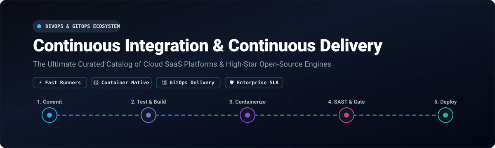

# 🚀 Awesome-Continuous-Integration-Delivery-CI-CD

  

  
  
  
  
  
  

## 🌟 Top Continuous Integration & Delivery (CI/CD) Ecosystem

**Curated List of Production SaaS Platforms & High-Star Open-Source GitHub Projects**  
*Focused on Pipeline Orchestration, Container-Native Builds, DevSecOps & GitOps Delivery*  
**Last updated: October 2026**

This repository tracks notable **SaaS platforms** and **open-source projects** for **Continuous Integration & Delivery (CI/CD)**. These tools enable modern engineering teams to automate build, test, lint, packaging, container security, and cloud deployment workflows—from managed cloud runners with zero configuration to self-hosted, air-gapped, container-native engines that offer complete control over infrastructure, artifacts, and compliance.

### 📌 Table of Contents
- [📊 Sector Overview & Market Dynamics](#-sector-overview--market-dynamics)
- [☁️ SaaS/Hosted Platforms](#️-saashosted-platforms)
- [🔓 Open-Source GitHub Projects](#-open-source-github-projects)
- [🤝 How to Contribute](#-how-to-contribute)
- [💖 Support](#-support)
- [📈 Star History](#-star-history)
- [⚠️ Disclaimer](#️-disclaimer)

---

## 📊 Sector Overview & Market Dynamics

The global Continuous Integration and Continuous Delivery (CI/CD) and Automated Software Delivery market is estimated at approximately **$4.5B to $5.5B** in 2025–2026, expanding at a robust double-digit CAGR of 15–19%. The sector exhibits **moderate concentration with strong platform-consolidation dynamics**—hyperscalers and unified source-code forge ecosystems (Microsoft/GitHub Actions, AWS, GitLab, Atlassian) capture dominant market share through developer lock-in, while specialized delivery and modern orchestration vendors (Harness, CircleCI) maintain defensible niches around enterprise governance, hybrid infrastructure, and advanced pipeline intelligence.

---

## ☁️ SaaS/Hosted Platforms

| Platform | Parent Company / Developer | Company Scale (Valuation / Revenue) | Starting Paid Tier Pricing | Free Tier / Trial Limits | Key Features & Focus |
| :--- | :--- | :--- | :--- | :--- | :--- |
| **AWS CodePipeline** | Amazon (AWS) | **$2.2T+ Market Cap** (~$105B+ AWS annual run-rate) | **$1.00 / active pipeline / month** (V1) or pay-per-action-minute (V2) | **1 free active pipeline/month** (V1) or **100 free action execution minutes/month** (V2) across the AWS account | Managed pipeline orchestration deeply integrated with AWS CodeBuild, CodeDeploy, S3, and ECS/EKS. |
| **Azure Pipelines** | Microsoft | **$3.1T+ Market Cap** (~$245B+ annual revenue) | **$40 / month** per additional Microsoft-hosted parallel job ($15/mo for self-hosted) | **1 free Microsoft-hosted parallel job** (1,800 min/mo, max 60 min/job) + **1 free self-hosted parallel job** (unlimited mins) for up to 5 users | Multi-platform cloud/on-prem CI/CD with native Azure DevOps integration and matrix builds across OS runners. |
| **GitHub Actions** | Microsoft (GitHub) | **$3.1T+ Market Cap** (GitHub ARR: ~$1B–$2B) | **$4.00 / user / month** (GitHub Team tier) | **2,000 build minutes/month** for private repos (unlimited for public open-source repos) + 500 MB artifact storage | Native GitHub workflow orchestration with 2,000+ Marketplace Actions, matrix jobs, and reusable workflows. |
| **Bitbucket Pipelines** | Atlassian | **~$45B Market Cap** (~$4.4B annual revenue) | **$3.00 / user / month** (Bitbucket Standard tier, includes 2,500 mins/mo) | **50 build minutes/month** pooled per workspace, up to 5 users, 1 GB storage, max 10 concurrent steps | Integrated Bitbucket Cloud pipelines configured via `bitbucket-pipelines.yml` with native Jira and deployment tracking. |
| **GitLab CI/CD** | GitLab Inc. (NASDAQ: GTLB) | **~$8B–$9B Market Cap** (~$700M+ annual ARR) | **$29.00 / user / month** (GitLab Premium tier) | **400 compute minutes/month** on shared runners, max 5 users per private top-level namespace, 10 GiB storage | All-in-one DevSecOps platform featuring Auto DevOps, DAG pipelines, review apps, and container registry. |
| **Harness** | Harness Inc. | **$5.5B Valuation** (Series E; ~$250M ARR) | **Custom per-developer license** (~Essentials tier quote) + compute consumption | **Free Forever Tier**: 1,000 to 2,000 free cloud build credits/month, GitOps & CI modules, community support | AI-driven test intelligence, automated pipeline rollbacks, cloud cost management, and native GitOps engine. |
| **CircleCI** | Circle Internet Services | **$1.7B Valuation** (Series F; ~$55.7M ARR) | **$15.00 / month** (CircleCI Performance plan) | **30,000 free credits/month** (~3,000 build minutes on standard Linux runner), up to 5 users, 30 concurrent jobs | High-speed container builds, Orb ecosystem, Docker layer caching, test splitting, and SSH debug access. |
| **TeamCity Cloud** | JetBrains | **Private / Bootstrapped** (~$710M annual revenue) | **$45.00 / month** for first 3 committers (+$15/committer/month, includes 24,000 build credits) | **14-day free trial** with 12,000 build credits and 120 GB storage *(On-prem Professional edition: Free forever with 3 build agents & 100 configurations)* | JetBrains-integrated CI/CD engine featuring Kotlin DSL pipeline-as-code and smart parallel test execution. |
| **Travis CI** | Idera, Inc. | **~$1.1B+ Parent Valuation** (Idera revenue ~$345M; Travis CI standalone ~$5M–$10M) | **$69.00 / month** (Core 1-concurrent job plan) | **14-day free trial** with 10,000 build credits (~1,000 Linux build minutes) for up to unlimited users *(Free credits upon request for OSS)* | Established cloud CI with straightforward YAML syntax and multi-language pre-configured build environments. |

---

## 🔓 Open-Source GitHub Projects

*Sorted descending by GitHub stargazers count. Stars_Badges reflect live counts and link directly to stargazers pages.*

- ### 1. **[act](https://github.com/nektos/act)** 
  - **Run your GitHub Actions locally** using Docker (MIT License).
  - Fast feedback loop without committing or pushing changes to remote repositories; reads `.github/workflows` files directly and emulates GitHub runner environments seamlessly.

- ### 2. **[Drone CI](https://github.com/harness/drone)** 
  - **Pioneering container-native continuous delivery platform** written in Go (Polyform Small Business License).
  - Defined the modern Docker container-per-step pipeline execution model; note that the community has largely transitioned maintenance to its active fork, Woodpecker CI.

- ### 3. **[Jenkins](https://github.com/jenkinsci/jenkins)** 
  - **The most widely deployed open-source CI/CD automation server** (MIT License).
  - Holds 28% global enterprise adoption; provides unmatched extensibility with 1,800+ plugins, bespoke pipeline-as-code via Jenkinsfile, and full control over on-premises security boundaries.

- ### 4. **[Argo CD](https://github.com/argoproj/argo-cd)** 
  - **Declarative continuous delivery and GitOps engine for Kubernetes** (Apache-2.0 License).
  - CNCF Graduated project; continuously monitors running applications against Git-stored manifests, automating drift detection and zero-downtime cluster synchronization.

- ### 5. **[Argo Workflows](https://github.com/argoproj/argo-workflows)** 
  - **Container-native workflow and DAG orchestration engine for Kubernetes** (Apache-2.0 License).
  - Excels in orchestrating massive parallel build jobs, machine learning pipelines, and multi-step data processing pipelines natively on K8s clusters.

- ### 6. **[Dagger](https://github.com/dagger/dagger)** 
  - **Programmable CI/CD engine run as code** (Apache-2.0 License).
  - Founded by Docker co-founder Solomon Hykes; replaces brittle shell scripts with typed SDKs (Go, Python, TypeScript) running inside portable containerized runtimes locally and in any CI platform.

- ### 7. **[Earthly](https://github.com/earthly/earthly)** 
  - **Supercharged container build automation** combining Dockerfile syntax and Makefile pragmatism (MPL-2.0 License).
  - Provides deterministic, hermetic, and parallelized caching across environments, eliminating "it works on my machine" pipeline failures.

- ### 8. **[Spinnaker](https://github.com/spinnaker/spinnaker)** 
  - **Enterprise multi-cloud continuous delivery platform** originally created by Netflix (Apache-2.0 License).
  - Built for high-velocity software releases, automated canary deployments, blue/green rollout pipelines, and cluster management across AWS, GCP, Azure, and Kubernetes.

- ### 9. **[Tekton Pipelines](https://github.com/tektoncd/pipeline)** 
  - **Industry standard Kubernetes-native CI/CD framework** (Apache-2.0 License).
  - Underpins Red Hat OpenShift Pipelines and Google Cloud Build; provides composable CRDs (Tasks, Pipelines, Runs) with enterprise LTS support.

- ### 10. **[Flux CD](https://github.com/fluxcd/flux2)** 
  - **Open and extensible continuous delivery solution for Kubernetes** (Apache-2.0 License).
  - CNCF Graduated project powering GitOps automation, automated image update policies, and multi-tenant release management.

- ### 11. **[Woodpecker CI](https://github.com/woodpecker-ci/woodpecker)** 
  - **Community-driven, container-native continuous integration engine** (Apache-2.0 License).
  - Active community fork of Drone CI; offers secure gRPC agent protocols, per-workflow permission trust models, and lightweight deployment via Docker or Kubernetes.

- ### 12. **[Concourse CI](https://github.com/concourse/concourse)** 
  - **Container-based pipeline automation system written in Go** (Apache-2.0 License).
  - Clean three-primitive architecture (Tasks, Resources, Jobs) providing stateless worker execution and native visualization of complex dependency graphs.

- ### 13. **[GoCD](https://github.com/gocd/gocd)** 
  - **Continuous delivery server by ThoughtWorks** (Apache-2.0 License).
  - Distinguished for end-to-end Value Stream Mapping (VSM), automated dependency tracking between pipelines, and enterprise deployment traceability.

- ### 14. **[Buildkite Agent](https://github.com/buildkite/agent)** 
  - **Reliable, cross-platform build runner for hybrid CI/CD architectures** (MIT License).
  - Executes build jobs securely on self-hosted infrastructure (bare-metal, AWS EC2, Kubernetes) while connecting to managed SaaS scheduling.

---

## 🤝 How to Contribute

Contributions are warmly welcome! You can help keep this catalog up to date and comprehensive:

1. 🍴 **Fork the repo** to your GitHub account.
2. 🌿 **Create a feature branch**: `git checkout -b add-awesome-tool`.
3. 📝 **Add/edit entries** in `README.md` keeping formatting consistent:
   - For SaaS tools: include verified starting price, free tier or trial specifications, and company metrics.
   - For Open-Source projects: include name, official repo link, social Stars_Badge linking to `/stargazers`, license, and key architecture strengths.
4. 🚀 **Submit a Pull Request** with a clear explanation of your changes.

---

## 💖 Support

If you found this curated CI/CD ecosystem guide helpful:

- ⭐ **Star this repository** to show your support and help other developers discover it!
- 🍴 **Fork and share** with your DevOps team, platform engineering group, and developer communities.
- ☕ **Buy me a coffee & become a sponsor**: Support ongoing open-source curation and research via the [GitHub Sponsor Dashboard](https://github.com/sponsors/ishandutta2007).

---

## 📈 Star History

---

## ⚠️ Disclaimer

- This list is **community-curated** for architectural comparison and research—not an exclusive endorsement.
- CI/CD platforms manage sensitive source code, pipeline secrets, and deployment keys; always ensure runner isolation (containers/VMs) and zero-trust credential rotation.
- **Open-source CI/CD is mature and production-ready**: Engines like Jenkins, Argo, Tekton, and Dagger offer battle-tested enterprise-grade alternatives to fully hosted vendor clouds.

---

  <b>Built for Platform Engineers, DevOps Practitioners, and SRE Teams.</b> 
  Let's make Continuous Integration &amp; Continuous Delivery faster, more observable, and cloud-native.

# Awesome-Continuous-Integration-Delivery-CI-CD

